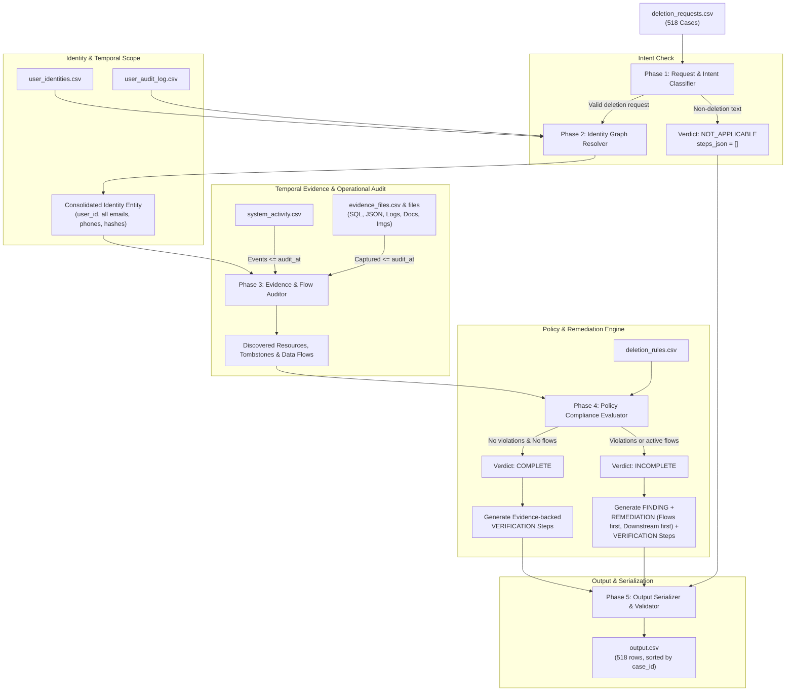

# Architecture & System Design: Ghost Data Still Exists

## 1. Challenge Overview & Problem Context

Northstar Shop faced a $2.4 million incident when a customer requested complete account deletion, the internal workflows claimed the deletion was **"Complete"**, but weeks later the user's personal data resurfaced. 

The root cause was ghost data dispersed across secondary datastores, logs, search indexes, analytics caches, support attachments, and unmanaged replicas. Furthermore, active background synchronization and restore processes recreated records that had been deleted from primary stores.

Northstar Shop requires an automated AI-powered **Deletion Audit Agent** to audit deletion requests, reconstruct ground-truth states across heterogeneous evidence artifacts, detect policy violations and data flow risks, and produce ordered remediation plans and verification checks.

---

## 2. Key Guidelines & Constraints

* **Dataset Isolation**: All inputs originate strictly from [`dataset/`](file:///home/desktop-rajesh2006/Projects/hackerrank-orchestrate-october26/dataset/). Organizer-only truth, golden labels, and generator scripts are never used.
* **Evaluation Target**: Exactly 518 cases in [`dataset/deletion_requests.csv`](file:///home/desktop-rajesh2006/Projects/hackerrank-orchestrate-october26/dataset/deletion_requests.csv) mapped to [`output.csv`](file:///home/desktop-rajesh2006/Projects/hackerrank-orchestrate-october26/output.csv) sorted by `case_id`.
* **Temporal Cutoff**: Decisions must be determined as of each case's `audit_at` timestamp. Evidence or activity dated after `audit_at` must not influence the verdict.
* **Trust Boundary**: `reported_status` (`COMPLETE`, `PARTIALLY_COMPLETE`, `NOT_STARTED`) and system messages are claims, not ground truth. State must be proven via concrete evidence.
* **Deletion Statuses**:
  * `NOT_APPLICABLE`: The request does not authorize deletion (e.g., access, export, rectification, opt-out). `steps_json` must be empty (`[]`).
  * `COMPLETE`: All relevant data treatments comply with [`dataset/deletion_rules.csv`](file:///home/desktop-rajesh2006/Projects/hackerrank-orchestrate-october26/dataset/deletion_rules.csv), required retentions exist, and no active sync/restore paths threaten data recreation. `steps_json` contains only evidence-backed verification steps.
  * `INCOMPLETE`: Unpurged PII, unredacted tombstones, or active replication/restore flows remain. `steps_json` contains findings, ordered remediation steps, and post-remediation verification checks.
* **Phases & Strict Sequencing**:
  1. `FINDING`
  2. `REMEDIATION`
  3. `VERIFICATION`
  * Within each phase, steps follow operation precedence, followed by ascending `system_id` and `resource_id`. Step numbers start at 1.

---

## 3. Dataset Inventory

| Dataset Asset | Path | Description |
|---|---|---|
| Evaluation Requests | [`dataset/deletion_requests.csv`](file:///home/desktop-rajesh2006/Projects/hackerrank-orchestrate-october26/dataset/deletion_requests.csv) | 518 production cases to audit |
| Sample Requests | [`dataset/sample_deletion_requests.csv`](file:///home/desktop-rajesh2006/Projects/hackerrank-orchestrate-october26/dataset/sample_deletion_requests.csv) | 32 calibration cases |
| Sample Canonical Answers | [`dataset/sample_output.csv`](file:///home/desktop-rajesh2006/Projects/hackerrank-orchestrate-october26/dataset/sample_output.csv) | Ground truth for sample requests |
| Identity Snapshots | [`dataset/user_identities.csv`](file:///home/desktop-rajesh2006/Projects/hackerrank-orchestrate-october26/dataset/user_identities.csv) | 850 current user identity records |
| Identity Audit History | [`dataset/user_audit_log.csv`](file:///home/desktop-rajesh2006/Projects/hackerrank-orchestrate-october26/dataset/user_audit_log.csv) | 306 historical field change records |
| Operational Stream | [`dataset/system_activity.csv`](file:///home/desktop-rajesh2006/Projects/hackerrank-orchestrate-october26/dataset/system_activity.csv) | 4,011 sync, backup, restore, and delete events |
| Deletion Policy Rules | [`dataset/deletion_rules.csv`](file:///home/desktop-rajesh2006/Projects/hackerrank-orchestrate-october26/dataset/deletion_rules.csv) | 15 formal rules (rule_01 to rule_15) |
| Evidence Manifest | [`dataset/evidence_files.csv`](file:///home/desktop-rajesh2006/Projects/hackerrank-orchestrate-october26/dataset/evidence_files.csv) | 94 multi-modal evidence files metadata |
| Multi-Modal Evidence | [`dataset/evidence/`](file:///home/desktop-rajesh2006/Projects/hackerrank-orchestrate-october26/dataset/evidence/) | Databases (SQL), logs, JSON, PDFs, screenshots |

---

## 4. System Architecture

---

## 5. Detailed Pipeline Phases

### Phase 1: Request & Intent Classification
* Multilingual NLP parser to evaluate `request_text`.
* Identifies genuine deletion authorization vs non-deletion inquiries (access, export, rectification, opt-out).
* Direct short-circuit to `NOT_APPLICABLE` with `steps_json=[]` if deletion is not authorized.

### Phase 2: Identity Graph Resolution
* Matches request `email` across both `user_identities.csv` (current snapshot) and `user_audit_log.csv` (historical values).
* Derives the full subject identity bundle:
  * Primary `user_id` and internal account IDs.
  * Current and historical email addresses.
  * Phone numbers.
  * Full legal and display names.
  * Hashed identifiers (e.g. SHA-256 email hashes).

### Phase 3: Temporal Evidence & Operational Auditor
* Filters all data streams strictly by timestamp $\le$ `audit_at`.
* **Activity Stream**: Scans `system_activity.csv` for:
  * Synchronization jobs connecting sources to targets (`REPORT_ACTIVE_DATA_FLOW`).
  * Restore jobs / backup restoration pipelines (`REPORT_RESTORE_RISK`).
  * Workflow audit logs and operational events.
* **Evidence Files**: Scans `dataset/evidence/`:
  * **Databases (`databases/*.sql`)**: Executes SQLite snapshots (read replicas, regional replicas, failover replicas, search clusters) to inspect accounts, users, and audit records.
  * **Structured Records (`records/*.json`, `*.txt`)**: Scans export bundles and handovers.
  * **Logs (`logs/*.log`)**: Detects unredacted emails, search logs, telemetry, and delivery traces.
  * **Documents & Images (`documents/*.pdf`, `images/*.png`)**: Extracts text/PII from invoices, admin screenshots, and support registers.

### Phase 4: Policy & Remediation Engine
* Evaluates discovered records against `deletion_rules.csv`:
  * `rule_01` to `rule_04`: Unconditional deletion for profiles, secondary IDs, search entries, cache.
  * `rule_05`: Redact support messages if shared context exists.
  * `rule_06`: Delete support attachments belonging solely to user.
  * `rule_07` & `rule_08`: Anonymize analytics profiles and telemetry.
  * `rule_09` & `rule_10`: Delete user exports and marketing profiles.
  * `rule_11`: Redact emails in delivery logs.
  * `rule_12` to `rule_14`: Retain security logs, active legal holds, and blocked backups.
  * `rule_15`: `ACCOUNT_TOMBSTONE` preserves internal `user_id` while redacting all direct identifiers.
* **Remediation Plan Ordering**:
  1. Disable active data flows (`DISABLE_DATA_FLOW`) and block restores (`BLOCK_RESTORE`).
  2. Remediate downstream copies before source records.
  3. Execute required actions: `DELETE_RECORD`, `REDACT_RECORD`, `ANONYMIZE_RECORD`.
  4. Post-remediation verification checks (`VERIFY_*`).

### Phase 5: Deterministic Serializer & Evaluation Harness
* Formats `steps_json` strictly:
  * `step_no` (1..N)
  * `phase` (`FINDING` $\to$ `REMEDIATION` $\to$ `VERIFICATION`)
  * Allowed operation ordering within phase.
  * Ascending order of `system_id` and `resource_id`.
  * Proper citation: `evidence_id` populated for findings/complete verifications; empty `""` for incomplete remediations/verifications.
* Sorts output by `case_id`.
* Generates required evaluation metrics:
  * `evaluation/evaluation_report.md`
  * `evaluation/usage_report.md`

---

## 6. Allowed Operations Matrix

| Phase | Operation | State | Meaning | Evidence Cited? |
|---|---|---|---|---|
| `FINDING` | `REPORT_REMAINING_RECORD` | `PRESENT` | Prohibited record still exists | Yes (`file_id`/`activity_id`/`audit_id`) |
| `FINDING` | `REPORT_EXPOSED_PII` | `PRESENT` | Allowed record still contains exposed PII | Yes |
| `FINDING` | `REPORT_ACTIVE_DATA_FLOW` | `ACTIVE` | Sync job can recreate deleted data | Yes |
| `FINDING` | `REPORT_RESTORE_RISK` | `ACTIVE` | Backup/restore path can restore data | Yes |
| `REMEDIATION` | `DISABLE_DATA_FLOW` | `DISABLED` | Terminate/disable replication pipeline | No (`""`) |
| `REMEDIATION` | `BLOCK_RESTORE` | `BLOCKED` | Prevent restore from restoring subject data | No (`""`) |
| `REMEDIATION` | `DELETE_RECORD` | `ABSENT` | Delete entire record | No (`""`) |
| `REMEDIATION` | `REDACT_RECORD` | `REDACTED` | Remove direct PII; keep permissible record/tombstone | No (`""`) |
| `REMEDIATION` | `ANONYMIZE_RECORD` | `ANONYMIZED` | Irreversibly unlink record from subject | No (`""`) |
| `VERIFICATION` | `VERIFY_RECORD_ABSENT` | `ABSENT` | Confirm record is purged | Yes (Complete) / No (Incomplete) |
| `VERIFICATION` | `VERIFY_RECORD_PRESENT` | `PRESENT` | Confirm policy-retained record is kept | Yes (Complete) / No (Incomplete) |
| `VERIFICATION` | `VERIFY_RECORD_REDACTED` | `REDACTED` | Confirm direct PII removed | Yes (Complete) / No (Incomplete) |
| `VERIFICATION` | `VERIFY_RECORD_ANONYMIZED` | `ANONYMIZED`| Confirm unlinking is complete | Yes (Complete) / No (Incomplete) |
| `VERIFICATION` | `VERIFY_DATA_FLOW_DISABLED`| `DISABLED` | Confirm data flow stopped | Yes (Complete) / No (Incomplete) |
| `VERIFICATION` | `VERIFY_RESTORE_BLOCKED` | `BLOCKED` | Confirm restore path blocked | Yes (Complete) / No (Incomplete) |
